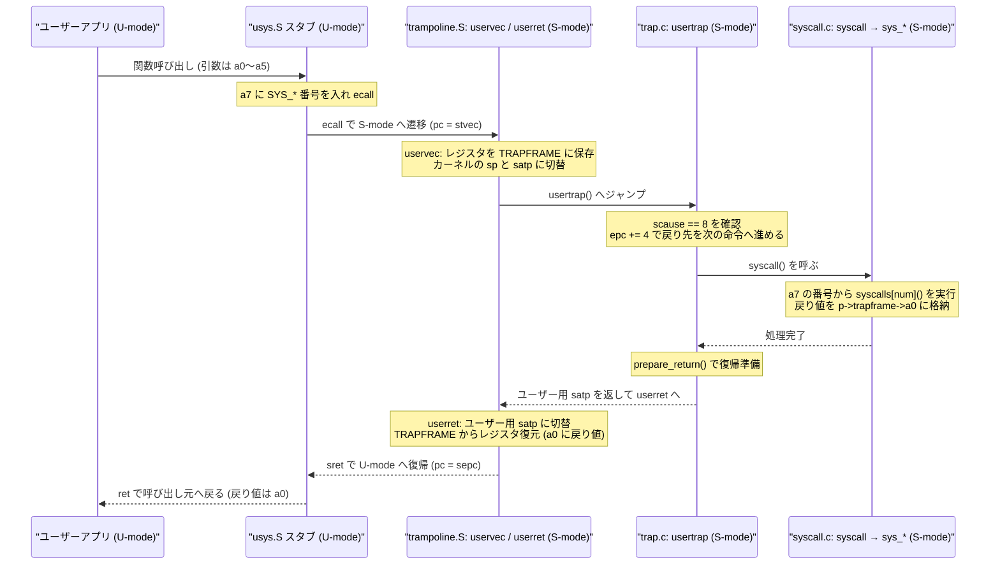

# 第4章 トラップとシステムコール（1）アプリからOSに処理を頼む

> - **対象コード**: `mit-pdos/xv6-riscv` コミット [`e93dabeb98431235c6e1a101cb96c73c923fdbc4`](https://github.com/mit-pdos/xv6-riscv/tree/e93dabeb98431235c6e1a101cb96c73c923fdbc4)（リポジトリ直下の `VERSIONS.md` と同一）
> - **対応する教科書**: MIT 教科書 **第4章 4.1〜4.4節**（*Traps and system calls*） ／ 菅原訳 **第4章 4.1節・4.3節・4.5節・4.6節**（「トラップとデバイスドライバ」）に対応（全体の対応は [教科書との対応表](books-map.md)、和訳とのコード差分は [第4章の差分メモ](books/trap-diff.md) を参照）

C 言語で画面に文字を出すとき、`printf` や `write` を呼び出します。ところが、アプリ自身のコードには「画面の装置に電気信号を送る処理」はどこにも書かれていません。実は、アプリは途中で OS（カーネル）にバトンを渡し、代わりに仕事をしてもらっています。

この「アプリから OS に処理を頼む仕組み」が**システムコール（system call）**です。この章では、なぜそんな回りくどい仕組みが必要なのかという疑問から出発し、xv6 の実際のコードを追いながら、自分で数行の改造を入れて動きを確かめます。

---

## 1. 困りごと

もしシステムコールという仕組みがなく、すべてのアプリがハードウェアやメモリを自由に触れたらどうなるでしょうか。

たとえば、xv6 の中で動く `echo` や自作の小さなプログラムが、ディスク装置や他のプログラムのメモリに直接読み書きできる世界を想像してみてください。すぐに次の3つの問題が起きます。

1. **うっかりミスで全体が壊れる**  
   あるアプリでポインタの計算を1つ間違えただけで、ディスク上の大事なファイルを上書きしたり、OS 本体のメモリを壊してコンピュータ全体をフリーズさせたりしてしまいます。
2. **他のアプリの情報を盗み見られる**  
   別のプログラムが扱っているデータや履歴を、無関係なアプリが勝手に読み取れてしまいます。
3. **装置を取り合って出力が混ざる**  
   2つのアプリが同時に画面やディスクの装置へ命令を送ると、文字やデータが途中で混ざり合って壊れてしまいます。

つまり、「便利だから何でも自由に触らせる」わけにはいきません。普段動くアプリには**自分の持ち分のメモリだけ**を触らせ、ディスクや画面、プロセス管理といった危険な操作は**OS（カーネル）だけ**が行えるように閉じ込める必要があります。

しかし、アプリを完全に閉じ込めてしまうと、今度は画面に1文字出すことすらできません。そこで必要になるのが、**「OS が用意した決められた入口を通って、安全に処理を頼む」ための仕組み＝システムコール**です。

---

## 2. 直観的な説明

システムコールの動きは、**ガラスの仕切りがある役所の窓口**にたとえるとイメージしやすくなります。

- **ロビー（ユーザー空間）**にいる来庁者（アプリ）は、自分で奥の事務室に入って台帳（ディスクや OS の管理表）を書き換えることはできません。仕切りで物理的に止められているからです。
- 何か手続きをしたいときは、窓口のトレイに「**手続き番号**（例：16番＝文字を書く）」と「**必要な情報**（出力先、文字の場所、文字数）」を置き、呼び鈴（`ecall` 命令）を鳴らします。
- 呼び鈴が鳴ると、**事務室（カーネル空間）**の担当者（カーネル）が決められた受付窓口に出てきます。
- 担当者は番号と中身に不正がないか確かめ、事務室の中で安全に作業を行い、結果（「2文字書けました」）をトレイに置いてロビー側へ制御を返します。

この仕切りと窓口があるおかげで、来庁者が勝手な場所へ入り込むのを防ぎつつ、必要な仕事だけを確実に引き受けられます。

### 比喩と実際が違う点

窓口の比喩は全体の流れを掴むのに便利ですが、実際のコンピュータ（xv6 と RISC-V CPU）とは大きく違う点が3つあります。ここを押さえておくと、このあとのコードが一気に読みやすくなります。

1. **「アプリ」と「カーネル」という2人の人間が向かい合っているわけではない**  
   窓口では来庁者と職員が別々の人間です。しかし実際のコンピュータでは、**たった1つの CPU コア**が、さっきまでアプリの命令を実行していたかと思えば、次の瞬間には自分の「権限スイッチ」を切り替えてカーネルの命令を実行し始めます。いわば「1人の作業員が、帽子をかぶり直して事務室側へ回る」動きに近いです。
2. **「トレイ」は紙ではなく、CPU の中にある少数のレジスタ**  
   手続き番号や引数は、CPU の中にある `a0`〜`a7` という小さな置き場所（レジスタ）に入れて渡します。CPU コアにレジスタは1組しかないため、カーネルが自分の計算を始める前に、アプリが使っていたレジスタの値をいったんメモリへ丸ごと退避しなければなりません。
3. **ロビーからは事務室の中が「ガラス越しに見える」のではなく、そもそも番地が存在しない**  
   xv6 では、アプリごとに見えているメモリの地図（ページテーブル）そのものがカーネルと別になっています。アプリ側からカーネルのメモリや装置を覗こうとしても、地図に載っていないか「通行禁止」の印がついているため、触れた瞬間に CPU がエラー（例外）を起こして止めます。

---

## 3. 正確な仕組み

ここからは、比喩を離れて xv6（RISC-V 64ビット版）で実際に起きていることを順番に追います。

### ユーザーモードとスーパーバイザーモード

RISC-V の CPU には、「いま実行中のコードにどこまで権限を与えるか」を表すモードがあります。xv6 が日常的に切り替えて使うのは次の2つです。

- **ユーザーモード（U-mode）**: `sh` や `echo` などのアプリが動くモードです。自分のメモリを計算することはできますが、CPU の設定変更命令や、ユーザー許可印（`PTE_U`）のないメモリへのアクセスは CPU ハードウェアによって拒否されます。
- **スーパーバイザーモード（S-mode）**: xv6 のカーネルが動く特権モードです。ページテーブルの切り替えやハードウェア装置の操作を行えます。

アプリが勝手にスーパーバイザーモードへ切り替える命令を実行しようとしても、CPU が不正とみなして拒否します。正当に切り替える唯一の手段が、専用命令の **`ecall`**（Environment Call）です。

### 引数と戻り値の受け渡し（`a0`〜`a7`）

!!! info "補足：レジスタとプログラムカウンタ（`pc`）"
    **レジスタ**は、CPU の内部に組み込まれた超高速な変数です。RISC-V（64ビット）には 64ビット幅の汎用レジスタが32個あり、`a0`〜`a7`、`t0`〜`t6`、`sp`（スタックポインタ）、`ra`（関数の戻り番地）といった名前がついています。  
    これとは別に、CPU は「いま何番地の命令を実行しているか」を指す **プログラムカウンタ（`pc`）** や、特権モード用の制御レジスタ（`sepc`、`scause`、`stvec`、`satp` など）を持っています。

xv6 では、アプリがシステムコールを呼ぶとき、`a0`〜`a7` のレジスタを次の約束で使います。

| レジスタ | システムコール呼び出し時の役割 | システムコール終了時の役割 |
| --- | --- | --- |
| `a0` | 第1引数 | **戻り値**（成功時の結果やエラーの `-1`） |
| `a1`〜`a5` | 第2引数〜第6引数（xv6 が使うのは最大6個） | 呼び出し前の値に戻る |
| `a6` | （RISC-V の規約上は引数用だが xv6 では未使用） | 呼び出し前の値に戻る |
| `a7` | **システムコール番号**（例：`SYS_write` = `16`） | 呼び出し前の値に戻る |

C 言語で普通の関数 `write(1, "hi", 2)` を呼ぶときも、RISC-V のコンパイラは最初から第1引数を `a0`、第2引数を `a1`、第3引数を `a2` に入れます。そのため、ユーザー側の小さな入口関数（スタブ）は **「`a7` にシステムコール番号を入れて `ecall` を実行するだけ」** で済みます。

### 往復の全体像

`ecall` が実行されてからアプリへ戻ってくるまでの流れを図にすると、次のようになります。



それぞれのステップで何が起きているかを確かめましょう。

1. **`ecall` がハードウェアで行う4つのこと**  
   `ecall` 命令が実行されると、CPU はハードウェアの回路だけで瞬時に次の4つを行います。
   - 権限をユーザーモードから**スーパーバイザーモード**へ引き上げる（同時に割り込みを一時停止する）。
   - `ecall` 命令自身の番地（`pc`）を **`sepc`** レジスタに記録する。
   - トラップが起きた理由を表す番号 **`8`**（「ユーザーモードからの `ecall`」）を **`scause`** レジスタに書き込む。
   - あらかじめカーネルが **`stvec`** レジスタに登録しておいた受付番地（`trampoline` 内の `uservec`）へ `pc` をジャンプさせる。

   ここで大事なのは、**CPU はこれ以外のことを自動ではやってくれない**という点です。ページテーブル（`satp`）はまだユーザー用のままですし、スタックポインタ（`sp`）もユーザー用のまま、汎用レジスタ（`a0`〜`a7` など）も保存されていません。いきなり C 言語の関数を動かすと、ユーザーのレジスタやスタックを壊してしまいます。

2. **`trampoline`（`uservec`）でレジスタ保存と地図の切り替えを行う**  

   !!! info "補足：ページテーブル（`satp`）とトラップフレーム（`struct trapframe`）"
       - **ページテーブル**: アプリが使う仮想アドレスを、実際の物理メモリの番地へ変換する「地図」です。CPU の `satp` レジスタに地図の番地を入れると、その瞬間から見えるメモリ空間が切り替わります。
       - **トラップフレーム（`kernel/proc.h` の `struct trapframe`）**: プロセスごとに1ページずつ用意された「退避用シート」です。ユーザー空間の天井近くにある決まった番地 `TRAPFRAME` に置かれており、アプリの31個のレジスタを保存する欄と、カーネルのスタック番地やページテーブル番地をあらかじめ控えておく欄が並んでいます。

   なぜ `trampoline`（トランポリン＝飛び込み台）という特別なページがあるのでしょうか。`uservec` の途中で `satp` をユーザー用の地図からカーネル用の地図へ書き換えた瞬間、CPU は「次の命令」を新しい地図で探しに行きます。もしその命令の番地が新しい地図に載っていなければ、その場で暴走してしまいます。そこで xv6 は、`trampoline` の1ページだけは**ユーザー用とカーネル用の両方の地図でまったく同じ最高番地（`TRAMPOLINE`）に配置**しています。だから地図を切り替えても足場が消えず、そのまま走り続けられるのです。

   `uservec` はアプリのレジスタ一式を `TRAPFRAME` に保存し、同じシートからカーネル用のスタック（`kernel_sp`）とページテーブル（`kernel_satp`）を読み込んで切り替え、C 言語の関数 `usertrap` へ飛びます。

3. **`usertrap` と `syscall` で本来の仕事をする**  
   ここから先はカーネルの C コードです。`usertrap` は `scause` が `8`（システムコール）であることを確認すると、保存しておいた戻り先番地 `p->trapframe->epc` に **`4` を足します**。RISC-V の `ecall` 命令は4バイト長なので、4を足しておかないと、戻ったときにまた同じ `ecall` を実行して無限ループしてしまうからです。  
   続いて `syscall` 関数が呼ばれ、`p->trapframe->a7` に入っている番号を使って対応する関数（`sys_write` や `sys_kill` など）を呼び出し、その戻り値を `p->trapframe->a0` に書き込みます。

4. **`userret` と `sret` でアプリへ帰る**  
   仕事が終わると、`prepare_return` で復帰の準備を整えてから `trampoline.S` の `userret` へ戻ります。`userret` はページテーブルをユーザー用に戻し、`TRAPFRAME` からすべてのレジスタを復元します。このとき `p->trapframe->a0` に書き込まれていた**戻り値が `a0` レジスタに入ります**。最後に特権命令 **`sret`** を実行すると、CPU はユーザーモードに戻り、`sepc` が指す `ecall` の次の命令（`ret`）からアプリの実行を再開します。

---

## 4. 関連コード

上の流れを、実際の `xv6-riscv/` のソースコードで順番に確かめましょう。各コードブロックの上にあるリンクから、上流リポジトリの該当箇所をそのまま開けます。

### ① ユーザー側の入口：`user/usys.pl` → `user/usys.S`

xv6 では、`write` や `kill` などの入口となるアセンブリコードを人間が手書きせず、ビルド時に Perl スクリプト `user/usys.pl` の `entry` サブルーチンで自動生成しています。

<!-- xv6ref: user/usys.pl#entry -->

`user/usys.pl` の後半では `entry("fork");`、`entry("write");`、`entry("kill");` のようにシステムコール名を順番に渡してこの `entry` を呼び出しています。ビルド時に `perl user/usys.pl > user/usys.S` が実行されると、たとえば `write` に対して次の短いアセンブリコードが出力されます。

```asm
.global write
write:
 li a7, SYS_write
 ecall
 ret
```

やってることは驚くほどシンプルです。

1. `li a7, SYS_write` で、`a7` レジスタにシステムコール番号 `SYS_write`（`kernel/syscall.h` で `16` と定義）を入れます。第1〜第3引数は呼び出し元がすでに `a0`、`a1`、`a2` に入れています。
2. `ecall` でカーネルへ飛び込みます。
3. カーネルから戻ってきたら、`ret` で呼び出し元の C 関数へ帰ります。戻り値はすでに `a0` に入っています。

### ② カーネルへの飛び込み台：`kernel/trampoline.S` の `uservec`

`ecall` の直後に CPU がジャンプしてくるのが、`kernel/trampoline.S` の `uservec` ラベルです。

!!! info "補足：ここで出てくる RISC-V アセンブリ命令"
    - `csrw csr, reg` / `csrr reg, csr`: CPU の制御レジスタ（CSR）に値を書き込む（write）／読み出す（read）命令です。
    - `li reg, 値`: レジスタに決まった数値（定数）を入れます。
    - `sd reg, offset(base)`: レジスタの 64ビット値（doubleword）を、メモリ番地 `base + offset` に保存（store）します。
    - `ld reg, offset(base)`: 逆にメモリ番地 `base + offset` から 64ビット値をレジスタへ読み込み（load）ます。
    - `jalr reg`: レジスタに入っている番地の関数へジャンプします。

<!-- xv6ref: kernel/trampoline.S#uservec -->

注目したい工夫が先頭の `csrw sscratch, a0` です。レジスタを `TRAPFRAME` メモリへ保存するには、まずどこかのレジスタに `TRAPFRAME` の番地を入れる必要があります。しかし、いきなり `li a0, TRAPFRAME` を実行すると、アプリが第1引数として `a0` に入れていた値が消えてしまいます。

そこで `uservec` は、まず予備の小箱である `sscratch` レジスタにユーザーの `a0` を一時避難させます。そのあと `a0` に `TRAPFRAME` の番地を入れて他のレジスタを次々と `sd` で保存し、最後に `csrr t0, sscratch` で取り出した元の `a0` をオフセット `112(a0)`（`p->trapframe->a0`）に保存しています。

保存が終わると、`sp`（カーネルスタック）、`tp`（実行中の CPU コア番号）、`t0`（ジャンプ先の `usertrap` 関数）、`t1`（カーネルのページテーブル）を読み込み、`csrw satp, t1` でページテーブルを切り替えてから `jalr t0` で `usertrap` を呼び出します。

### ③ トラップの振り分け：`kernel/trap.c` の `usertrap`

ページテーブルとスタックがカーネル用に切り替わったので、ここからは C 言語で書かれた `kernel/trap.c` の `usertrap` 関数が動きます。

<!-- xv6ref: kernel/trap.c#usertrap -->

システムコールに関係する急所は次の4か所です。

- `w_stvec((uint64)kernelvec);`  
  すでにカーネル内部に入ったため、もしこの最中にタイマーなどの割り込みが起きたら、ユーザー用の `uservec` ではなくカーネル用の入口 `kernelvec` で受け止めるように切り替えます。
- `p->trapframe->epc = r_sepc();`  
  `ecall` 実行時点のプログラムカウンタ（`sepc`）をプロセスの `trapframe` に保存します。処理中に別のプロセスへ切り替わると CPU の `sepc` レジスタが上書きされる可能性があるため、プロセス専用のメモリへ移しておきます。
- `if (r_scause() == 8)` と `p->trapframe->epc += 4;`  
  `usertrap` にはシステムコールだけでなく、タイマー割り込みやページフォルトもやってきます。`r_scause() == 8` なら「ユーザーモードからの `ecall`」だと分かるので、戻り先を次の命令へ進めるために `epc` に `4` を足し、`intr_on()` で割り込みを許可してから `syscall()` を呼びます。
- `prepare_return();` と `return satp;`  
  帰り支度をして、ユーザー用ページテーブルの値を `return` します。呼び出し元であった `trampoline.S` では `uservec` のすぐ下に `userret` が続いており、そのままユーザー空間への復帰処理へ進みます。

### ④ 番号から関数を引いて実行する：`kernel/syscall.c` の `syscall`

`usertrap` から呼ばれる `kernel/syscall.c` の `syscall` 関数は、システムコールの司令塔です。

!!! info "補足：構造体ポインタ（`->`）と関数ポインタ配列"
    - **構造体ポインタの `->`**: xv6 では、実行中のプロセス1つ分の情報を `struct proc` という構造体にまとめています。`myproc()` は「いまこの CPU で動いているプロセスの `struct proc` へのポインタ `p`」を返します。ポインタ `p` が指す構造体の中身を取り出す記法が `p->pid` や `p->trapframe->a7` です。
    - **関数ポインタ配列 `syscalls`**: `kernel/syscall.c` で定義されている `syscalls` は、「システムコール番号を添字にすると、対応する処理関数（`sys_fork` や `sys_write` など）が取り出せる配列」です。`if (num == 1) ... else if (num == 2) ...` と長い分岐を書かずに、`syscalls[num]()` の1行で目的の関数を呼び出せます。

<!-- xv6ref: kernel/syscall.c#syscall -->

処理の流れはとても明快です。

1. `num = p->trapframe->a7;` で、アプリが `a7` に入れておいたシステムコール番号を取り出します。
2. `num` が有効な範囲内にあり、`syscalls[num]` に関数が登録されているかを確かめます。
3. `p->trapframe->a0 = syscalls[num]();` で対応する関数を呼び出し、その結果を `p->trapframe->a0` に代入します。ここに書いた値が、帰り道でアプリの `a0` レジスタ（戻り値）になります。
4. もし存在しない番号が渡されたら、`printk` でエラーメッセージを表示し、戻り値を `-1` にします。

### ⑤ システムコール本体の例：`kernel/sysproc.c` の `sys_kill`

最後に、`syscalls[num]()` の先で実際に呼ばれる関数の例として、指定したプロセス ID に終了要求を送る `kernel/sysproc.c` の `sys_kill` を見てみましょう。

!!! info "補足：C のポインタ渡し（`&pid`）"
    C 言語では、関数に普通の変数 `pid` を渡すと値のコピーだけが渡るため、呼び出された関数の中から元の `pid` を書き換えることができません。  
    そこで `&pid`（「変数 `pid` のメモリアドレス」）を渡します。受け取る側の `argint(int n, int *ip)` は `*ip = ...` と書くことで、呼び出し元の `pid` に直接値を入れてくれます。

<!-- xv6ref: kernel/sysproc.c#sys_kill -->

少し不思議に見えるのが、ユーザー側の `kill(int pid)` には引数があるのに、カーネル側の `sys_kill(void)` の引数リストは `void`（引数なし）になっている点です。

理由はここまで追ってきた仕組みそのものです。アプリの引数は C の関数呼び出しとして直接渡ってくるのではなく、`uservec` によって `p->trapframe->a0` に保存されています。そのため、`syscalls` 配列に並べる関数はすべて同じ型 `uint64 sys_xxx(void)` に統一しておき、各関数の中で `argint(0, &pid)`（`0` 番目の引数＝`p->trapframe->a0` を整数として取り出す補助関数）を呼んで値を受け取る設計になっているのです。

そして `return kkill(pid);` で返した値（成功なら `0`、対象が見つからなければ `-1`）が、`syscall` 関数によって `p->trapframe->a0` に書き込まれ、アプリの手元へ届きます。

---

## 5. 小さな改造

コードの流れが見えたところで、`kernel/syscall.c` の `syscall` 関数に数行だけ手を入れて、**「アプリがどのシステムコールを呼び、どんな戻り値が返ったか」を画面に表示する改造**を試してみましょう。

すべてのプロセスで表示すると `sh`（シェル）の入力待ちだけで画面が埋まってしまうため、今回はプロセス名（`p->name`）が `"echo"` のときだけ **`pid: syscall 名前 -> 戻り値`** と表示します。

### 変更する内容

`xv6-riscv/kernel/syscall.c` に次の2か所を追加します（パッチファイルは `docs/labs/syscall-trace.patch` に用意してあります）。

1. `syscalls` 配列のすぐ下に、番号からシステムコール名の文字列を引く配列 `syscallnames` を追加します。
2. `syscall` 関数の中で `p->trapframe->a0 = syscalls[num]();` を実行した直後に、プロセス名が `"echo"` なら `printk` で表示する処理を追加します。

`syscall` 関数に追加するコードは次の5行だけです。

```c
    p->trapframe->a0 = syscalls[num]();
    if (strncmp(p->name, "echo", sizeof(p->name)) == 0 &&
        num < NELEM(syscallnames) && syscallnames[num]) {
      printk("%d: syscall %s -> %d\n", p->pid, syscallnames[num],
             (int)p->trapframe->a0);
    }
```

- `strncmp(p->name, "echo", sizeof(p->name)) == 0` は、現在実行中のプロセス名 `p->name` が `"echo"` と一致するかを調べています。
- `p->trapframe->a0` の型は符号なし64ビット整数（`uint64`）なので、`printk` の `%d`（符号付き32ビット整数）に合わせて `(int)` にキャストしています。

### 実験ブランチで試す手順

`master` ブランチを汚さないよう、`scripts/exp` で実験用ブランチを切ってからパッチを当てます（`scripts/exp` は初回コミット済みのリポジトリで動作します。詳しい条件は [xv6 実験環境ガイド](env.md) を参照してください）。

```sh
# 1. 実験ブランチ exp/syscall-trace を作成して切り替え
./scripts/exp syscall-trace

# 2. 用意されているパッチを適用（自分で kernel/syscall.c を編集しても構いません）
git apply docs/labs/syscall-trace.patch

# 3. ビルドして xv6 を起動
./scripts/run
```

xv6 の `$` プロンプトが出たら、`echo hi` と入力して Enter を押します。観察が終わったら **`Ctrl-a` を押して離し、続けて `x`** で QEMU を終了します。

実験を終えて元の `master` ブランチへ戻すときは、次のコマンドを実行します。

```sh
# パッチを取り消してビルド生成物を掃除し、元のブランチへ戻る
git apply -R docs/labs/syscall-trace.patch
./scripts/clean
./scripts/exp back
```

!!! tip "自動検証スクリプトで一発確認する"
    リポジトリ直下で次のコマンドを実行すると、「パッチの一時適用 → ビルド → QEMU 起動 → `echo hi` と `ls` の検証 → パッチの取り消しとクリーンアップ」までを自動で行えます（コミット前の作業ツリーでも実行できます）。
    ```sh
    ./scripts/check-lab syscall-trace
    ```

---

## 6. 予想と実行結果

実行結果を見る前に、`echo` プログラム自身のコード（`user/echo.c` の `main`）を見て、どんな出力になるか予想してみましょう。

<!-- xv6ref: user/echo.c#main -->

### 実行前の予想

`echo hi` を実行すると、`argc` は `2`、`argv[1]` は `"hi"` になります。`main` のコードを素直に読むと、次のように予想したくなります。

- ループの中で `"hi"`（2バイト）を出力する `write` が1回呼ばれ、戻り値 `2` が表示されるはず。
- 続けて改行 `"\n"`（1バイト）を出力する `write` がもう1回呼ばれ、戻り値 `1` が表示されるはず。
- 最後に `exit(0)` が呼ばれて、`exit -> 0` のような行が表示されて終わるはず。

本当にそうなるでしょうか。`./scripts/check-lab syscall-trace` を実際に動かしたログを見てみましょう。

### 実際の実行結果

以下は `./scripts/check-lab syscall-trace` 実行時に採取されたログ（`logs/lab-syscall-trace.log`）からの抜粋です。

```text
xv6 kernel is booting

hart 1 starting
hart 2 starting
init: starting sh
$ echo hi
3: syscall exec -> 2
hi3: syscall write -> 2

3: syscall write -> 1
$ ls
.              1 1 1024
..             1 1 1024
README         2 2 2441
...
```

予想と比べてみると、**3つの面白い違い**が見つかります。どれもバグではなく、システムコールの本当の仕組みを映し出しています。

1. **最初に `3: syscall exec -> 2` が出ているのはなぜ？**  
   シェル（`sh`）は `fork` で子プロセス（PID 3）を作ったあと、`exec("echo", ...)` を呼んで自分の中身を `echo` プログラムに入れ替えます。`exec` が呼ばれた入口の時点ではプロセス名はまだ `"sh"` ですが、`sys_exec`（内部の `kernel/exec.c` の `kexec`）の中で**プロセス名 `p->name` が `"echo"` に書き換えられてから `syscall` 関数に戻ってきます**。そのため `syscalls[num]()` の直後に置いた判定に引っかかり、`exec` の完了が表示されたのです。なお戻り値の `2` は `echo` に渡された引数の個数（`argc`＝`"echo"` と `"hi"` の2個）で、これがそのまま `a0` レジスタに入って `main(int argc, ...)` の第1引数になります。
2. **`hi` のすぐ後ろに `3: syscall write -> 2` がくっついているのはなぜ？**  
   1回目の `write(1, "hi", 2)` は改行を含まない2文字 `"hi"` だけを画面に出力します。画面への出力は `syscalls[num]()`（`sys_write`）の中で行われるため、まず画面に `hi` が出力され、その直後に `syscall` 関数の `printk` が同じ行に続けて `3: syscall write -> 2` を出力したのです。そして2回目の `write(1, "\n", 1)` で先に改行が出力されるため、空行が1つ入ってから `3: syscall write -> 1` が表示されています。
3. **最後に呼んだはずの `exit(0)` が表示されないのはなぜ？**  
   `echo` は確かに最後で `exit(0)` を呼んでいます。しかし、カーネル側の `sys_exit`（内部の `kernel/proc.c` の `kexit`）はプロセスを終了状態にして別のプロセスへ CPU を明け渡してしまうため、**二度と `syscall` 関数の `syscalls[num]()` の次の行へ戻ってきません**。だから呼び出し完了後に置いた `printk` は実行されないのです。

さらに、続けて実行した `ls` ではトレースが1行も出ていないことから、`p->name` による絞り込みが狙いどおり機能していることも確認できます。

---

## 7. 説明のために省略したこと

この章ではシステムコールの往復の骨格に集中するため、次の事柄をあえて省略しました。今後ほかの章やコードを読むときの手がかりとして頭に入れておいてください。

- **ポインタ引数を安全に読み取る仕組み（`copyin` / `copyinstr`）**  
  `write(1, "hi", 2)` の第2引数のように、アプリがメモリアドレス（ポインタ）を渡すシステムコールがたくさんあります。カーネルのページテーブルとユーザーのページテーブルは別物なので、カーネルはその番地をそのままポインタとして読むことはできません。また、悪意やバグのある番地を渡される危険もあります。xv6 では `kernel/syscall.c` の `fetchstr` や `kernel/vm.c` の `copyin`・`copyinstr` を使い、ユーザーのページテーブルを検査しながら安全にデータをコピーしています。
- **RISC-V のマシンモード（M-mode）**  
  実は RISC-V CPU には、スーパーバイザーモードよりさらに上の「マシンモード（M-mode）」があります。xv6 では電源投入直後の `kernel/start.c` だけがマシンモードで動き、「例外や割り込みはすべてスーパーバイザーモードで直接受け取る」という委譲設定（`medeleg` / `mideleg`）を済ませてからスーパーバイザーモードへ移ります。そのため、普段のシステムコールではマシンモードは登場しません。
- **システムコール以外のトラップ（割り込みとページフォルト）**  
  `uservec` や `usertrap` はシステムコール専用の道ではありません。実行中にタイマー割り込みが起きたときや、まだ割り当てていないメモリに触れたとき（ページフォルト）も、まったく同じ入口を通ってカーネルへ入ります。`usertrap` の中で `r_scause() == 8` を調べていたのは、それらとシステムコールを見分けるためです。
- **`sbrk` だけスタブ名が `sys_sbrk` になっている理由**  
  `user/usys.pl` の `entry` を見ると、`sbrk`（メモリを増やすシステムコール）のときだけラベル名を `sys_sbrk` にしています。これはユーザー側のライブラリ（`user/ulib.c`）に `sbrk` と `sbrklazy` という2つの関数があり、即時割り当てか遅延割り当てかの第2引数を添えてから `sys_sbrk` を呼ぶ二段構えになっているためです。

---

## 8. 確認問題

学んだ内容が定着しているか、4つの問いで確かめてみましょう。「答えを見る」をクリックすると解答と解説が開きます。

### 問1：レジスタの役割

ユーザープログラムが `write(1, "hi", 2)` を呼び出して `ecall` 命令を実行する直前、次の4つの値はそれぞれどのレジスタに入っていますか。また、書き込んだバイト数（戻り値）は最終的にどのレジスタに入って戻ってきますか。

- 第1引数 `1`（出力先のファイル記述子）
- 第2引数 `"hi"` の先頭アドレス
- 第3引数 `2`（バイト数）
- システムコール番号 `SYS_write`（`16`）

<details markdown="1">
<summary>答えを見る</summary>

- 第1引数 `1`：**`a0`**
- 第2引数 `"hi"` の先頭アドレス：**`a1`**
- 第3引数 `2`：**`a2`**
- システムコール番号 `SYS_write`（`16`）：**`a7`**
- 最終的な戻り値：**`a0`**（呼び出し時に第1引数が入っていた `a0` が、帰り道では戻り値で上書きされます）

</details>

### 問2：`epc += 4` を忘れたらどうなるか

`kernel/trap.c` の `usertrap` 関数には `p->trapframe->epc += 4;` という1行があります。もしこの1行をうっかり削除してしまったら、最初のシステムコールを実行したプロセスはどうなりますか。理由もあわせて考えてみましょう。

<details markdown="1">
<summary>答えを見る</summary>

**同じシステムコール（`ecall` 命令）を無限に繰り返し続け、その先に進めなくなります。**

`ecall` が起きた瞬間、CPU の `sepc` レジスタには「次の命令」ではなく「いま実行した `ecall` 命令自身の番地」が記録されます。`epc += 4` で4バイト先の `ret` 命令へ進めておかないと、`sret` でユーザーモードに戻った瞬間に再び同じ `ecall` 命令を実行してしまいます（なお、このとき `a0` レジスタは1回目の戻り値に書き換わっているため、2回目以降は第1引数が変わった状態で同じシステムコールが繰り返されます）。

</details>

### 問3：`uservec` の先頭で `sscratch` を使う理由

`kernel/trampoline.S` の `uservec` では、最初に `csrw sscratch, a0` を実行してから `li a0, TRAPFRAME` を実行しています。`sscratch` を使わずにいきなり `li a0, TRAPFRAME` と書いてはいけない理由を説明してください。

<details markdown="1">
<summary>答えを見る</summary>

**アプリが第1引数として `a0` レジスタに入れていた値が上書きされて消えてしまうからです。**

RISC-V の `sd`（メモリ保存）命令は、「ベースとなる番地が入ったレジスタ」を1つ必要とします。しかし `ecall` 直後は31個の汎用レジスタすべてにアプリの大事な値が入っている可能性があり、自由に潰せるレジスタが1つもありません。そこで、汎用レジスタではない特権用の小箱 `sscratch` にいったん `a0` を逃がすことで、`a0` を `TRAPFRAME` のベース番地用として使えるようにしています。

</details>

### 問4：`exit` もトレースに表示するには

第5節・第6節の改造実験では、`echo hi` の最後に呼ばれた `exit(0)` はトレースに表示されませんでした。もし `exit` が呼ばれた事実も画面に表示したい場合、`kernel/syscall.c` の `syscall` 関数をどのように工夫すればよいでしょうか。

<details markdown="1">
<summary>答えを見る</summary>

**`syscalls[num]()` を呼び出す「前」に（または `num == SYS_exit` のときだけ呼び出し前に）表示を入れます。**

`sys_exit` は内部で `kexit` → `sched` と進んでプロセスを終了させてしまうため、`syscalls[num]()` の後ろに書いた処理へは絶対に戻ってきません。そのため、`exit` を記録したい場合は `syscalls[num]()` を呼ぶ前に表示する必要があります。ただし、呼び出す前の時点ではまだシステムコールの戻り値は決まっていない（そもそも `exit` には戻り値がない）ため、`exit` については戻り値を表示しないか、`p->trapframe->a0` に入っている終了ステータス（`exit(0)` なら `0`）を表示するといった形になります。

</details>

---

## 9. 教科書と並べて読むときの注意

電気通信大学・菅原研究室による日本語訳（第4章「トラップとデバイスドライバ」）は 2019 年 10 月時点の英語原文をもとに翻訳されているため、このリポジトリの `xv6-riscv/`（2026 年 10 月時点）や最新の MIT 英語原文（第4章 *Traps and system calls*）とは、章の構成や関数名・実装がいくつか変わっています。和訳を手元に置いて読むときは、とくに次の点に注意してください。

- **章構成と節の順序が変わっている**  
  和訳の第4章に含まれていた「4.4 タイマ割込」と「4.7〜4.8 デバイスドライバ・コンソールドライバ」は、最新の英語原文では **第6章（*Interrupts and device drivers*）** へ分離されました。また、和訳では「4.2 カーネル空間からのトラップ → 4.3 ユーザ空間からのトラップ」の順でしたが、最新版では逆になり「4.2 ユーザ空間 → 4.5 カーネル空間」の順で説明されています。
- **`usertrapret()` が廃止され、`prepare_return()` ＋ `return satp` に変わった**  
  和訳（4.3節）では `usertrap()` の最後で `usertrapret()` を呼び、そこからトランポリンの `userret(satp, TRAPFRAME)` を関数呼び出ししていました。現在のコードには `usertrapret` という関数はなく、`prepare_return()` で復帰準備をしたあと、`usertrap()` がユーザー用ページテーブルの `satp` 値を `return satp;` で返して `trampoline.S` の `userret` へ直接戻る形になっています（最新の英語原文 4.2節も同様です）。
- **`sscratch` の使い方が「交換（`csrrw`）」から「退避（`csrw`）＋定数ロード（`li`）」に変わった**  
  和訳（4.3節）では、あらかじめ `sscratch` に `TRAPFRAME` を入れておき、`csrrw` 命令で `a0` と交換する仕組みでした。現在のコード（および最新原文 4.2節）では、`csrw sscratch, a0` で `a0` を退避したあと `li a0, TRAPFRAME` で定数番地を直接入れ、帰り道の `userret` では `sscratch` を使いません。
- **構造体メンバ名が `p->tf` から `p->trapframe` に変わった**  
  和訳で `p->tf`（`p->tf->a0` など）と書かれている箇所は、現在のコード（`kernel/proc.h`）および最新原文ではすべて `p->trapframe` です。
- **`user/initcode.S` が廃止された**  
  和訳（4.5節・2.6節）では、最初のプロセスが `user/initcode.S` から `exec` システムコールを呼ぶ例で説明されていますが、現在の `xv6-riscv/` に `user/initcode.S` は存在しません。最初のプロセスは `kernel/proc.c` の `forkret()` から直接カーネル関数 `kexec("/init", ...)` を呼び出して起動します。そのため最新原文 4.3節では、シェルの `write(2, "$ ", 2)` と `user/usys.S` のスタブを例に説明しています。
- **カーネル内の関数名がユーザー側と区別できるよう改名された**  
  - カーネル内のコンソール出力：`printf`（`kernel/printf.c`）→ **`printk`**（`kernel/printk.c`）
  - システムコール本体の内部関数：`exec` → **`kexec`**、`kill` → **`kkill`**、`fork` → **`kfork`**、`exit` → **`kexit`**、`wait` → **`kwait`**
  - 一時停止システムコール：`sleep`（`SYS_sleep`）→ **`pause`**（`SYS_pause` / `sys_pause`）
- **`sbrk` とページフォルトの扱いが変わった**  
  現在の `xv6-riscv/` では遅延割り当て（lazy allocation）に対応したため、`user/usys.pl` は `sbrk` だけ `sys_sbrk` スタブを生成し、`sys_sbrk` は第2引数（`SBRK_EAGER` / `SBRK_LAZY`）を受け取ります。これに伴い、`usertrap()` や `copyin()` / `copyinstr()`（第2引数に `p->sz` が追加）でも、未割り当てページへのアクセス時に `vmfault()` を呼ぶ処理が増えています（最新原文では新設の**第5章 *Page faults*** で扱われます）。

各変更点の詳しい対照表や、和訳第4章に含まれるタイマ割込（`timervec` 廃止 → `stimecmp` / `clockintr`）・コンソールドライバまわりの変更、`\lineref` の対応一覧は **[第4章 和訳とコードの差分メモ](books/trap-diff.md)** にまとめています。章全体の対応は **[教科書との対応表](books-map.md)** を参照してください。
